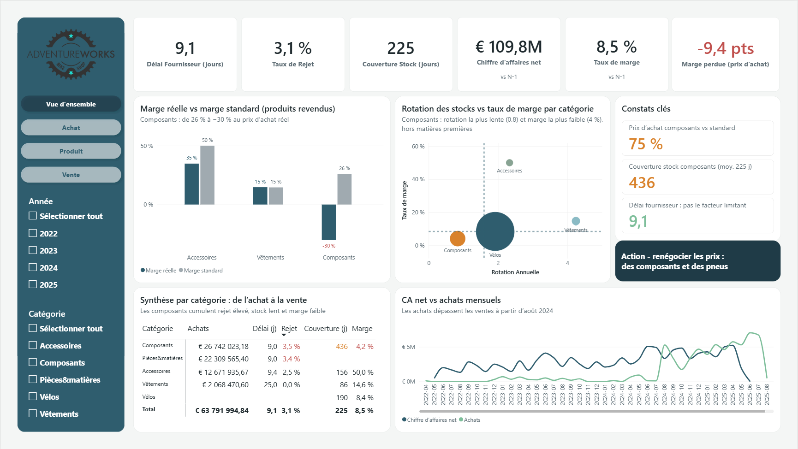
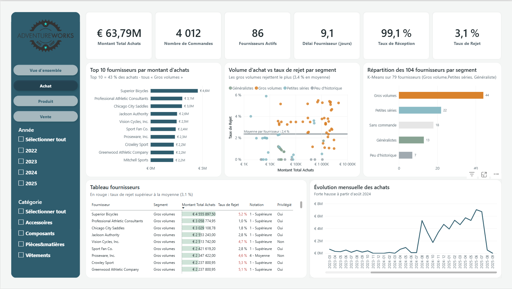
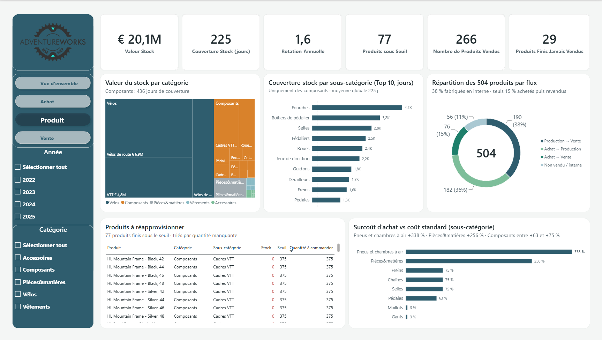
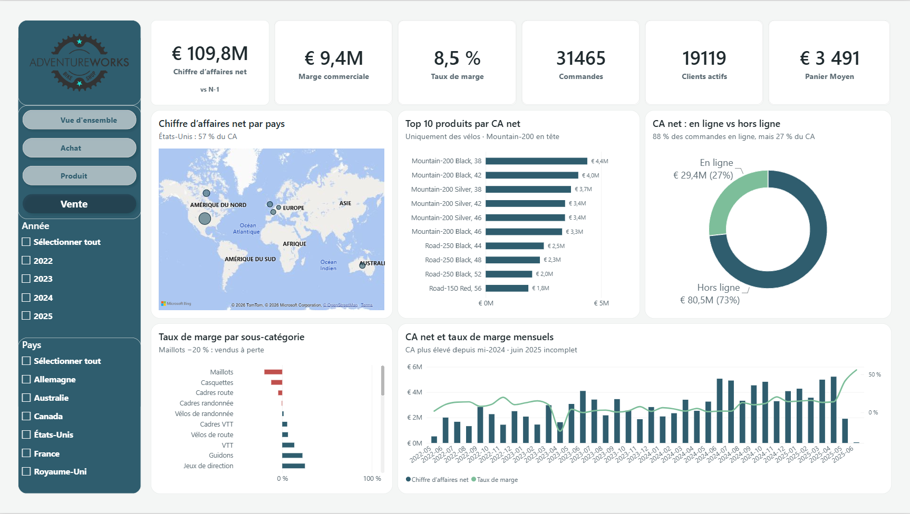

# 📦 AdventureWorks Supply Chain Analysis

Analyse de l'impact de la performance fournisseurs et de la rotation des stocks sur la marge commerciale, du diagnostic à la restitution.


## 🎯 Problématique

> Comment la performance des fournisseurs et la rotation des stocks influencent-elles la marge commerciale, de l'achat jusqu'à la vente ?

## 💡 Résultats clés

- **Le prix d'achat réel érode la marge** : sur les produits achetés puis revendus, la marge passe de 27,7 % (coût standard) à 18,3 % (prix d'achat réel), soit **−9,4 points**. L'écart se creuse : −10,4 pts en 2024, −14,2 pts au 1er semestre 2025.
- **Les composants cumulent les difficultés** : achetés environ 75 % au-dessus du coût standard, 436 jours de couverture de stock, 4,2 % de marge.
- **Le délai fournisseur n'est pas le facteur limitant** (9 jours en moyenne) ; le risque porte sur la qualité : les 10 premiers fournisseurs (43 % des achats) appartiennent tous au segment « Gros volumes », qui a le taux de rejet le plus élevé (3,4 %).
- **Action prioritaire** : renégocier les prix d'achat des composants et des pneus.

## 🗂️ Structure du projet

```
ProjetFinal/
├── raw_data/                     ← CSV bruts Microsoft à télécharger (lien dans la section Dataset)
├── clean_data/                   ← CSV avec en-têtes (généré par `add_headers.py`)
├── database/                     ← base SQLite générée (généré par `creat_bdd.py`)
├── docs/
│   └── AdventureWorks_Dictionnaire_de_donnees.md
├── img/                          ← captures et schémas
├── src/
│   ├── add_headers.py            ← ajout des en-têtes aux CSV bruts
│   ├── creat_bdd.py              ← création de la base SQLite
│   ├── import_csv.py             ← import des CSV dans SQLite
│   ├── creat_api.py              ← API FastAPI (CRUD) sur la base
│   ├── eda.ipynb                 ← analyse exploratoire
│   ├── check_missing.py          ← contrôle des valeurs manquantes
│   ├── nettoyage.py              ← traitement des valeurs manquantes
│   └── export_clean_parquet.py   ← export des tables utiles en Parquet
├── ml/
│   ├── clustering_fournisseur.ipynb   ← segmentation des fournisseurs
│   ├── stock_risk_prediction.ipynb    ← classification du risque de rupture
│   └── outputs/
├── parquet_for_powerbi/          ← fichiers Parquet chargés dans Power BI(générés par` export_clean_parquet.py`)
├── AdventureWorks.pbix           ← dashboard Power BI
├── AdventureWorks_theme.json     ← thème Power BI
├── requirements.txt
└── README.md
```

## 🔄 Pipeline

```
CSV bruts → Python (pandas) → SQLite → Parquet → Power BI
                                  ↘ API FastAPI
                                  ↘ Machine learning (scikit-learn)
```

1. **Récupération** des CSV AdventureWorks et stocker les dans `raw_data/`.
2. **`src/add_headers.py`** : ajoute les en-têtes officiels et écrit les CSV dans `clean_data/`.
3. **`src/creat_bdd.py`** : crée la base SQLite `database/adventureworks.db` en respectant l'ordre des clés étrangères.
4. **`src/import_csv.py`** : importe les 15 CSV de `clean_data/` dans la base (valeurs nulles marquées `null`).
5. **`src/creat_api.py`** : expose la base via une API FastAPI (opérations CRUD).
6. **`src/eda.ipynb`** et **`src/check_missing.py`** : analyse exploratoire (valeurs manquantes, cohérence des dates, intégrité référentielle : 11 contrôles validés).
7. **`src/nettoyage.py`** : traitement des valeurs manquantes et suppression des colonnes sans valeur analytique.
8. **`src/export_clean_parquet.py`** : export en Parquet des **13 tables utilisées** par le modèle Power BI (types corrigés : entiers, dates).
9. **`ml/clustering_fournisseur.ipynb`** : génère `parquet_for_powerbi/vendor_segments.parquet`.
10. **Power BI** : chargement des fichiers Parquet, modélisation en étoile, mesures DAX, 4 pages de restitution.

## 📊 Dashboard Power BI

| Page | Question | Contenu principal |
|---|---|---|
| **Vue d'ensemble** | Répond à la problématique | KPI avec évolution N-1, marge réelle vs standard, rotation vs marge, constats clés |
| **Achat** | Quels fournisseurs performent ? | Top 10 fournisseurs, segmentation des 104 fournisseurs, volume vs taux de rejet |
| **Produit** | Le stock est-il sain ? | Valeur et couverture du stock, produits sous le seuil, surcoût d'achat |
| **Vente** | D'où vient la marge ? | CA par pays, top produits, canal en ligne vs hors ligne, marge par sous-catégorie |

Modèle : 3 tables de faits (achats, ventes, stock), dimensions produit, fournisseur, client, territoire et calendrier. Comparaisons N-1 à période équivalente (`DATEADD`), les années 2022 et 2025 étant incomplètes.


### Achat


### Produit


### Vente



## 🤖 Machine learning

| Modèle | Méthode | Résultat |
|---|---|---|
| **Segmentation des fournisseurs** | K-Means (K = 3) sur les 79 fournisseurs ayant au moins 30 lignes d'achat, règles métier pour les 25 autres | 5 segments : Gros volumes (44), Petites séries (22), Sans commande (18), Généralistes (13), Peu d'historique (7) |
| **Risque de rupture de stock** | Régression logistique vs Random Forest, 151 produits finis | Régression logistique retenue : rappel 0,92, F1 0,56 (filtre d'alerte) |

## 🔐 Données et RGPD

Les données AdventureWorks sont **fictives**. La démarche appliquée est celle d'un contexte réel : principe de **minimisation** (RGPD, art. 5.1.c). La table `Person` (noms, données démographiques) n'est pas exportée vers Power BI, et les colonnes sans usage analytique sont retirées du modèle. Les fichiers de données ne sont pas versionnés.

## ⚙️ Installation et exécution

```bash
python -m venv venv
source venv/Scripts/activate        # Windows (Git Bash)
pip install -r requirements.txt

python src/add_headers.py
python src/creat_bdd.py
python src/import_csv.py
python src/nettoyage.py
python src/export_clean_parquet.py
```

Puis exécuter `ml/clustering_fournisseur.ipynb` (génère `vendor_segments.parquet`) et ouvrir `AdventureWorks.pbix` dans Power BI Desktop (Accueil → Actualiser).

## ⚠️ Limites

- Coût standard fixe, sans historique des coûts.
- Stock disponible uniquement à date (pas de stock moyen).
- Achats en cartons ou bidons, nomenclature en unités : pas de facteur de conversion.
- Ventes de mai 2022 à juin 2025, achats jusqu'en septembre 2025.

## 📚 Dataset

[AdventureWorks](https://github.com/microsoft/sql-server-samples/tree/master/samples/databases/adventure-works/oltp-install-script) — jeu de données open source de Microsoft.

## ✅ Suivi de projet

Tableau Trello : [adventureworks-supply-chain-analysis](https://trello.com/b/udYAed3U/adventureworks-supply-chain-analysis)

## 👤 Autrice

Xiaoqing ZHOU GRANDCOING — [Portfolio](https://xiaoqinggdc.github.io/) · [GitHub](https://github.com/XiaoqingGdc)
